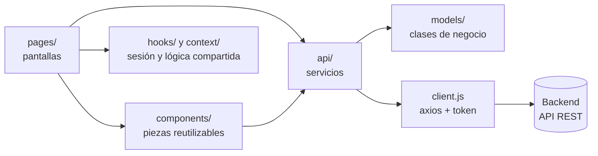

# Arquitectura del frontend - CanchaYa

App de una sola página (SPA) hecha con React 19 y Vite. Se comunica con el [backend](https://github.com/TatoCanob74/backendTPDesarrollo) por su API REST en JSON.

## 1. Capas



| Carpeta | Responsabilidad |
|:-|:-|
| `pages/` | Una carpeta por pantalla. Arma la vista, maneja el estado de la pantalla y llama a los servicios |
| `components/` | Piezas reutilizables: formularios, diálogos, layout. Reciben datos por props y avisan cambios por callbacks |
| `api/` | **Servicios**: una función por endpoint del backend. Ninguna pantalla usa axios directamente |
| `models/` | Clases de negocio que envuelven las respuestas de la API |
| `context/` y `hooks/` | Sesión del usuario (`AuthContext` + `useAuth`) y lógica compartida (`usePaymentReturn`, `useScrollReveal`) |
| `routes/` | `PrivateRoute` y `AdminRoute`: protección de pantallas por nivel |
| `styles/` | SCSS: tokens, mixins de breakpoints y un parcial por grupo de componentes |
| `utils/` | Funciones auxiliares: fechas, moneda, roles |

### Recorrido de una acción: cancelar una reserva

1. En `pages/reservas/Reservas.jsx`, el usuario toca **Cancelar** y confirma en `ConfirmDialog`.
2. La pantalla llama a `cancelReserve(id)` de `api/reserves.js`.
3. `api/client.js` (axios) agrega el header `Authorization: Bearer <token>` y hace `PATCH /reservas/:id/cancelar`.
4. Si el backend responde bien, la pantalla vuelve a pedir la lista y React la redibuja.
5. Si responde con error (por ejemplo, faltan menos de 6 horas), el `catch` muestra el mensaje del backend en un `alert`.

## 2. Pantallas y niveles de acceso

| Ruta | Pantalla | Acceso |
|:-|:-|:-|
| `/` | Home: presentación y deportes | Público |
| `/canchas` | Formulario de reserva: deporte, sede, complejo, día, horario y servicios | Público (para confirmar hay que iniciar sesión) |
| `/login`, `/register` | Inicio de sesión y registro | Público |
| `/verifyemail` | Ingreso del código de verificación del email | Público (se llega desde el registro o el login) |
| `/forgotpassword`, `/resetpassword` | Recuperación de la contraseña con código por mail | Público |
| `/pago/exito`, `/pago/error`, `/pago/pendiente` | Vuelta desde Mercado Pago | Público |
| `/reservas` | Mis reservas: detalle, pagar y cancelar | **Sesión** (`PrivateRoute`) |
| `/perfil` | Edición del perfil propio | **Sesión** (`PrivateRoute`) |
| `/admin` | Panel de administración | **ADMIN o SUPERADMIN** (`AdminRoute`) |
| `*` | Página 404 | Público |

**Cómo se protege:**

- `AuthContext` guarda el token JWT y lee del payload el usuario y su rol.
- `PrivateRoute` manda al login a quien no tiene sesión, y después del login lo devuelve a la pantalla que había pedido.
- `AdminRoute` manda a la home a quien no es administrador.
- Si el backend responde `401` (token vencido o inválido), el interceptor de `api/client.js` avisa y `AuthContext` cierra la sesión.

La protección del frontend es de experiencia de usuario. **La seguridad real la hace el backend**, que valida el token y el rol en cada pedido.

**Panel de administración por nivel** (`pages/admin/Admin.jsx`):

| Nivel | Solapas |
|:-|:-|
| `SUPERADMIN` | Complejos, Administradores, Canchas, Horarios, Localidades, Servicios, Usuarios, Reservas |
| `ADMIN` | Mi complejo, Canchas, Horarios, Reservas (solo de su complejo) |

## 3. Componentes: input y output properties

Los componentes reutilizables no tienen estado de negocio propio. Reciben los datos del padre (**input properties**) y le avisan lo que pasa con callbacks (**output properties**).

| Componente | Input properties | Output properties |
|:-|:-|:-|
| `LocationForm`, `ServiceForm`, `ComplexForm`, `CourtForm`, `HoraryForm`, `AdminForm` | El registro a editar (o `null` para crear), `submitting`, `error` y listas para los selects | `onSubmit(datos)`, `onCancel()` |
| `ConfirmDialog` | `open`, `title`, `message`, `confirmLabel`, `tone`, `busy` | `onConfirm()`, `onCancel()` |
| `ReserveDetailDialog` | `idReserve` | `onClose()` |
| `ReserveDetail` | `reserve` | - |
| `CodeInput` | `value`, `error`, `disabled` | `onChange(código)`, `onComplete(código)` |
| `MyComplexTab` | `complex` | `onUpdated()` |
| `SportCard` | `sport`, `name`, `desc`, `feats` | - |

Ejemplo en `pages/admin/LocationsTab.jsx`: la solapa le pasa a `LocationForm` la localidad a editar (input) y recibe los datos cargados por `onSubmit` (output) para mandarlos al backend.

## 4. Servicios y modelos

**Servicios (`api/`).** `client.js` crea una instancia de axios con la URL del backend (`VITE_API_URL`). Agrega el token a cada pedido y maneja el `401`. Sobre ese cliente, cada archivo agrupa los endpoints de un recurso: `auth`, `reserves`, `courts`, `horaries`, `locations`, `services`, `complexes`, `users`, `admin`.

**Modelos (`models/`).** Una clase por entidad de negocio: `Reserve`, `Court`, `Complex`, `Horary`, `Location`, `Service` y `User`. Exponen getters que concentran la lógica de presentación, por ejemplo:

- `reserve.formattedAmount` → `"$ 18.000"`
- `reserve.isPaid`, `reserve.canBeCancelled`, `reserve.canBePaid`
- `horary.label` → `"18:00 - 19:00"`
- `user.isAdmin`

**Patrones de diseño:**

- **Factory Method**: `Reserve.fromDTO(json)` y `Reserve.fromList(array)` construyen instancias a partir de los datos crudos de la API. Los mismos métodos existen en las demás clases.
- **Data Mapper**: la capa `api/` traduce entre el formato del backend y los modelos. Las pantallas reciben objetos `Reserve`, no JSON; si el backend cambia un campo, se ajusta un solo lugar.

```js
// api/reserves.js
export function getReserve(idReserve) {
  return client.get(`/reservas/${idReserve}`).then((r) => Reserve.fromDTO(r.data))
}
```

## 5. Estilos

Sass (SCSS) con estrategia **mobile-first**: el estilo base es el de celular, y los breakpoints agregan lo necesario para pantallas más grandes, siempre con `min-width`.

| Breakpoint | Mixin | Desde |
|:-|:-|:-|
| SM | `@include sm` | 480px |
| MD | `@include md` | 768px |
| LG | `@include lg` | 1024px |

`global.scss` importa los parciales con `@use`: `_tokens` (colores y tipografía como variables CSS), `_reset`, `_layout`, `_buttons`, `_nav`, `_hero`, `_cards`, `_forms`, `_tables`, `_modal`, `_footer` y `_animations`. Cada parcial que necesita un breakpoint importa `_mixins`. Las clases siguen una convención tipo BEM (`booking__foot`, `btn--primary`). Las animaciones respetan `prefers-reduced-motion`.

## 6. Manejo de errores

- Cada llamada a la API tiene su `catch`, y la pantalla muestra el mensaje que manda el backend en un `alert` (`role="alert"`). Si el backend no manda mensaje, se muestra uno genérico.
- Mientras se procesa un pedido, los botones se deshabilitan y muestran el estado ("Guardando…", "Verificando…").
- Las acciones destructivas piden confirmación con `ConfirmDialog`.
- Los formularios validan antes de enviar (formato de email, largo de contraseña, que las contraseñas coincidan), con un mensaje distinto para cada problema.

## 7. Ambientes

La URL del backend se configura con la variable `VITE_API_URL`. Vite carga `.env`, `.env.development` o `.env.production` según el modo (`npm run dev` o `npm run build`). Si no hay ninguno, se usa `http://localhost:3000`. Hay un ejemplo en `.env.example`.

## 8. Tests

| Tipo | Archivo | Qué prueba |
|:-|:-|:-|
| Unitario de componente | `src/components/bookingForm/BookingForm.test.jsx` | Horarios con su precio, total con servicios, sugerencias cuando no hay turnos |
| Unitario de componente | `src/pages/pago/PagoPendiente.test.jsx` | Espera y confirmación del pago |
| End-to-end | `cypress/e2e/accesoPorNiveles.cy.js` | Acceso a las pantallas según el nivel, contra el backend real |

Cómo correrlos: [README](../README.md#tests). Evidencia: [tests.md](https://github.com/TatoCanob74/backendTPDesarrollo/blob/master/docs/tests.md).
